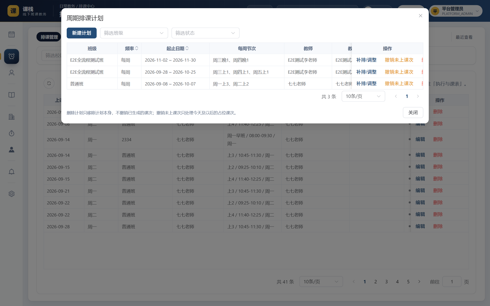
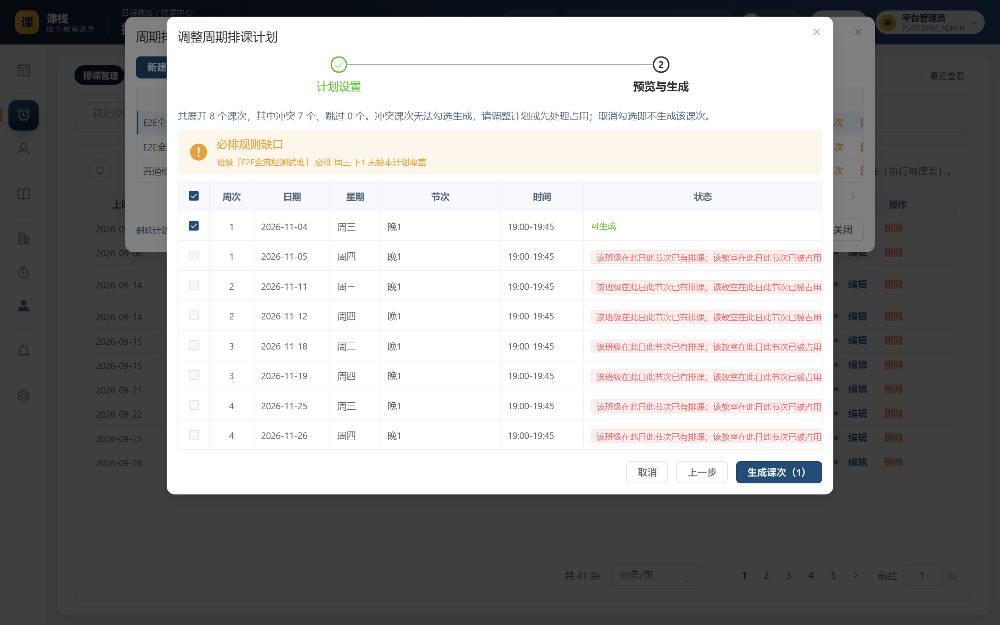
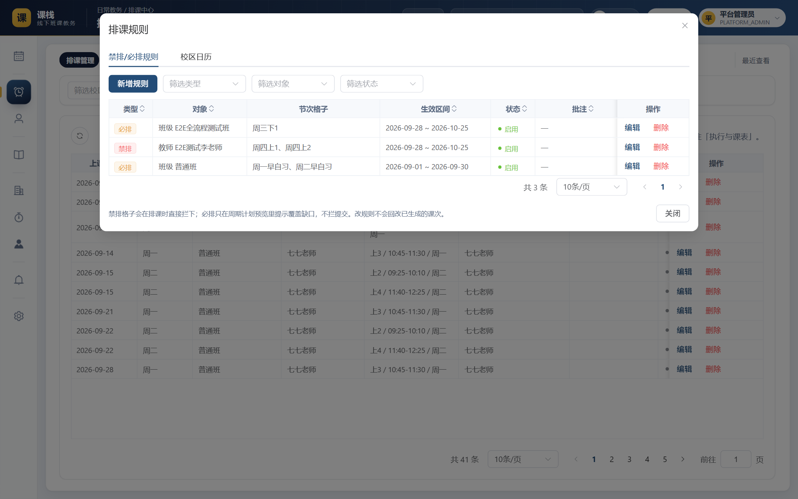
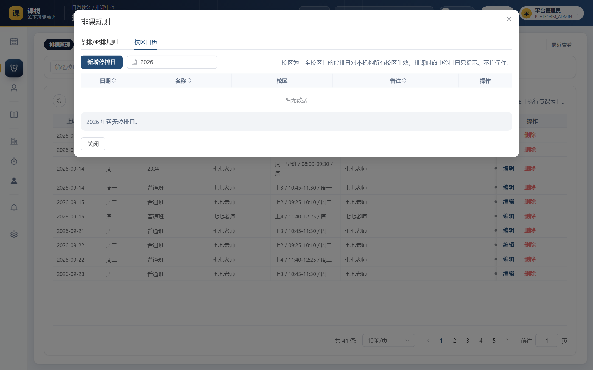
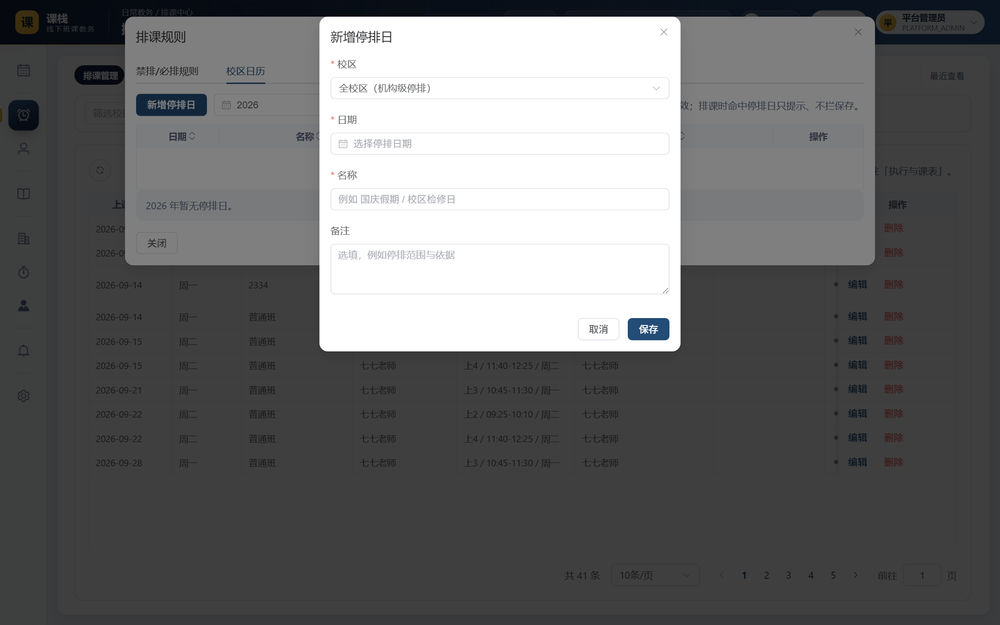
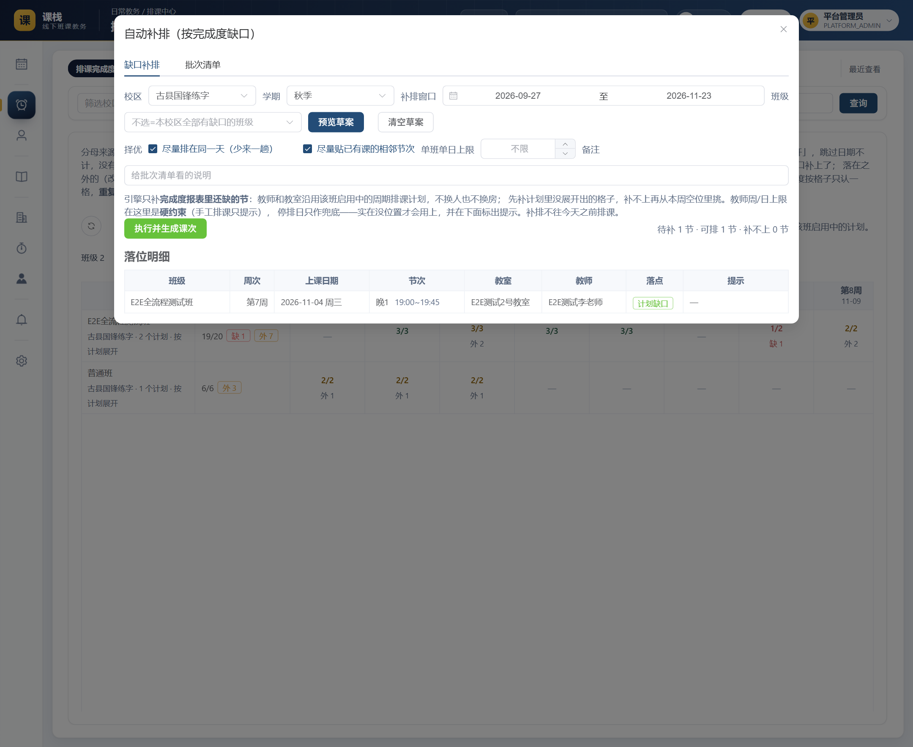
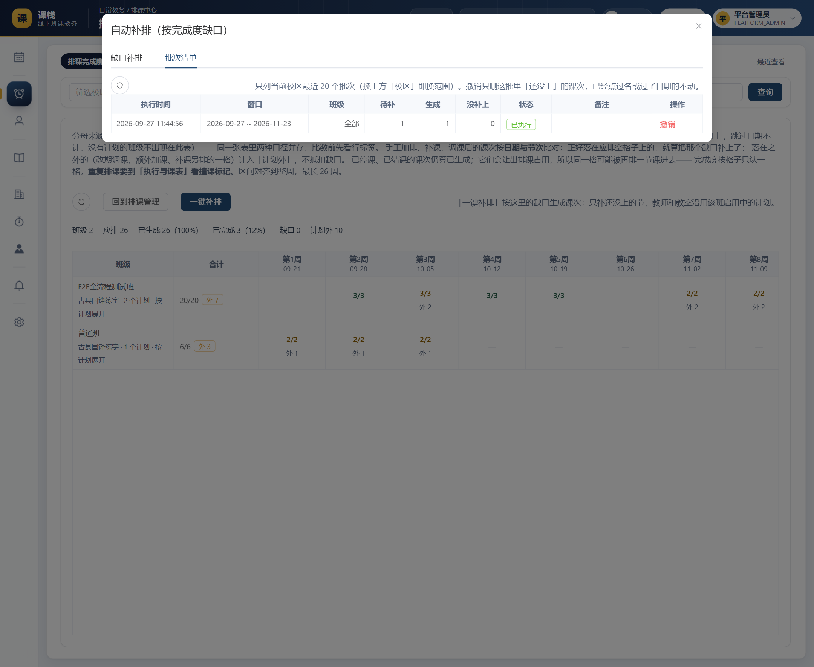
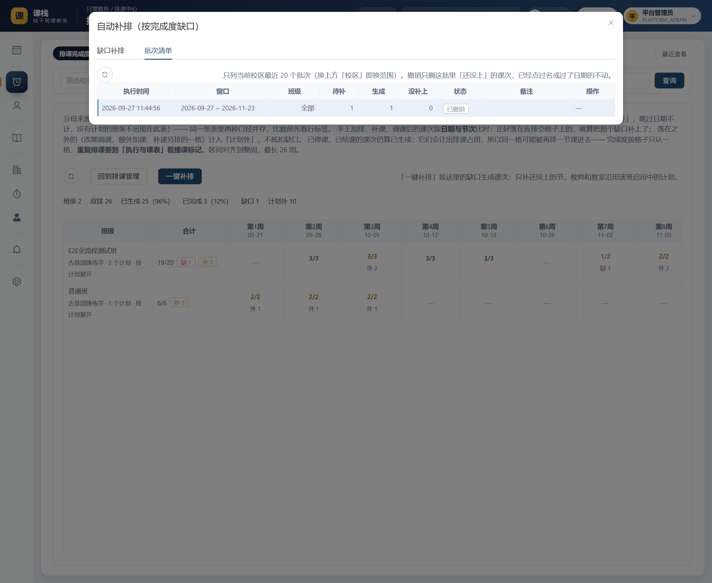
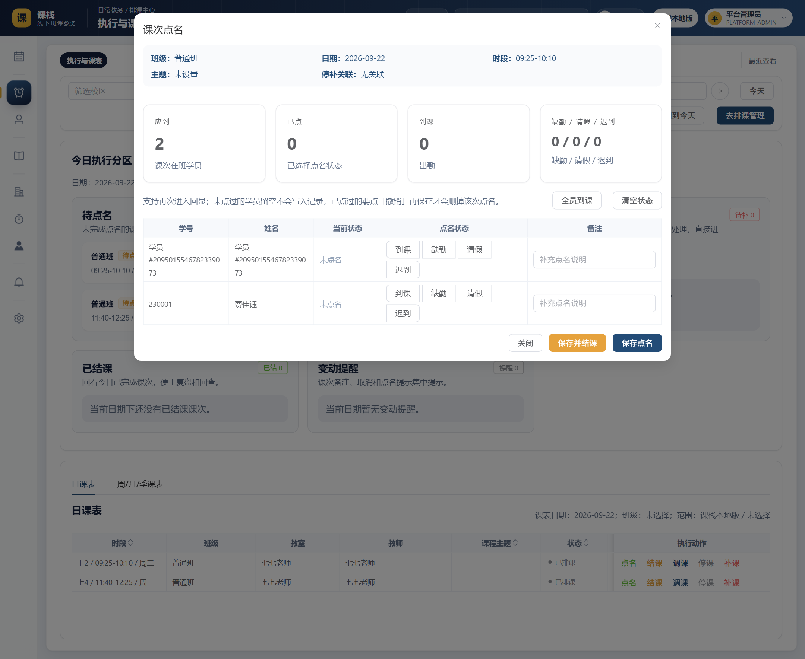

# 排课怎么用（大白话版）

一句话流程：**给班级定个目标 → 排一个周期计划 → 看看哪周缺课 → 点一下让系统补上 → 上课当天点名。**

前面这些都在左边菜单的「排课管理」和「排课完成度」两页里做，上课当天的事在「执行与课表」。

用之前先把这几样备好（括号里是对应的菜单页）：校区、教室（机构与教学资源）、学期（同上）、时间段（时间段设置）、老师（教师档案）、班级和学生（班级学员、报名与入班）。

---

## 第 1 步：告诉系统这个班上多少节课

菜单「班级学员」→ 找到班级 → 编辑。这里有两栏，**各管各的，可以同时填**：

- **课时目标**：这个班**一周该上几节**。手上没有"每周几节"这个数、只知道"一个月上 8 次"的，把口径切成**每月**、填 8，系统自己换算成每周几节，下面那一行会把算式写给你看（`每月 8 节 ≈ 每周 2 节（8×12÷52=1.85，四舍五入），报表按每周 2 节算`）。
- **整班总课时**：这个班**一共上多少节**（合同上写的那个总数，比如 40）。填了它，「排课完成度」那页才会显示"已上课 8/40"这种整班进度；它**不参与**"这周缺几节"的计算。

这个目标就是系统算账的依据：拿它算"这个班这周该上几节、实际上了几节、还差几节"。

两栏都能空着。空着表示没定目标，完成度那页会退回按这个班的周期计划算该上几节（行上标「按计划展开」）。

一个提醒：**一个月只上两三次**的班，换算到周不足 1 节，系统不会硬凑一个数，会直接说"未设周目标"。这种班建议只填整班总课时看进度。

## 第 2 步：排一个周期计划（一周固定那几节）

排课管理 → 点「周期计划」→「新建计划」。

怎么填，照着这几格：

- **班级 / 校区学期 / 授课老师 / 教室**：选就行。
- **排课频率**：每周都上选「每周」；隔一周上的选「单周」「双周」。
- **起止日期**：这门课从哪天上到哪天。
- **跳过日期**：中间要停课的那几个具体日期选上（停课日、节假日，可多选），这几天就不出课。
- **每周节次**：下面那张格子，点几下选出"每周几、第几节"。想一周上三次就点三个格子。

点「下一步：预览」，系统会把这个计划**摊开成每一节课**给你先看一眼。撞车的（老师/教室/班在同一时间已经有课）会标红并且勾不上，命中跳过日期的标黄，必排规则没满足的会在上面提示你。**确认没问题再点「生成课次」**，课表上才会真的多出这些课；不想生成的那一节，把勾去掉就行。

> 只想临时加一节课、或者改某一节：回排课管理点「新增排课」/在列表里点「编辑」，不用动整个计划。
> 点名、结课、停课、补课**不在这一页**，去「执行与课表」。

## 第 3 步：把不能排的时间圈出来（可选，但很有用）

排课管理 →「排课规则」→「新增规则」。

- **禁排**：这个班/老师/教室在这段时间**绝对不排课**（比如老师周三要出差）。排课时系统会直接拦下。
- **必排**：这个格子**必须排上**（比如每周三下午第一节是固定测验）。不拦你，只在预览时提醒你"这个要求没满足"。
- 对象选班级还是老师还是教室，生效区间填哪天到哪天，然后在格子上点要禁/要必的那几节。

## 第 4 步：放假、检修这些整天不上课的日子

同一个「排课规则」弹窗里换到「校区日历」页签 →「新增停排日」。

校区选「全校区」就是整个机构都不排；只选某个校区就那一处停。填日期和名字（比如"国庆假期"）就够了。

> 停排日是**提醒**，不是硬拦：真有需要照样能排进去，系统只是告诉你一声。

## 第 5 步：看排够了没有，哪周缺课

菜单进「排课完成度」。这是一张横着看周的表：一行一个班，一格是一周。

怎么读：

- `3/3` = 该上 3 节、上了 3 节，够了。
- 标 **缺 1** = 这周少一节，要补。
- 标 **外** = 计划之外多出来的课（手工加的、补课、调课），不算缺。
- 上面那行汇总：应排 / 已生成 / 已完成 / 缺口，一眼看整体。
- 班级名字下面还有一行「已上课 8/40 · 约 2027-01-17 上完」，这是**整班进度**，只有第 1 步填了整班总课时才出现。注意这里的"已上课"是**日期过了的课都算**（不管点没点结课），跟格子里那个"已完成"不是一回事，两个数对不上是正常的。后面那个日期按最近四周的节奏推的，写"约"就是推算、不是承诺；它要是比计划的结课日期还晚，整行会变红，意思是"照这个速度上不完这 40 节"。

## 第 6 步：缺点课，点一下让系统补

还是这一页，点「一键补排」。

- **校区 / 学期**：先在页面上方选好，弹窗会带过来。
- **补排窗口**：从哪天到哪天允许补，一般就是"今天往后几周"。
- 先点「预览草案」，系统算给你看：待补几节、能排几节、排不上的几节、分别落在哪天哪节。
- 看清楚没问题，再点「执行并生成课次」，课才真的进课表。

补的时候老师和教室沿用这个班正在用的计划，不会另外凭空安排。排不上的（时间都被占了）会告诉你原因，那几节手工处理。

## 第 7 步：补错了想撤回

同一个弹窗换到「批次清单」页签，找到那一次，点「撤销」。

只删这一批里**还没上的**课。已经点过名的、日期已经过去的，动不了 —— 那说明课上过了，得走停课/补课，不是撤销。

## 第 8 步：上课当天，点名、结课、停课、补课

菜单进「执行与课表」，上方选日期。

- 上面是今天要上的课，下面是日课表。
- 每节课后面有「点名 / 结课 / 调课 / 停课 / 补课」。
- 点名弹窗里给每个学生选到课、缺勤、请假、迟到；人齐就点「全员到课」省事，点错了可以「清空状态」重录。
- 「保存并结课」= 点名录完、这节课也算上完了；只想先记出勤就点「保存点名」。

---

## 几个常问的

**改完规则/计划，已经排好的课会跟着变吗？**
不会。规则和计划只管**以后**排的课，已经生成的课次要改就去改那一节。

**为什么有的课在课表上有、完成度里却算"计划外"？**
手工加的、补课、调课后的课，只要没落在计划该上的那个格子上，就记成"外"，不算缺课也不算达标。

**"课时目标"和周期计划的节次对不上怎么办？**
以课时目标算缺口。想让两者一致，就按目标节数去点计划的格子。

**只知道一个月上几次，不知道每周几节？**
不用自己算。编辑班级把课时目标的口径切成"每月"、填每月节数，系统换算并把算式显示给你看（见第 1 步）。

**整班总课时填了，为什么这周该上几节没变？**
它只管整班进度那一行，不参与每周应排节数的计算。每周该上几节只由课时目标（或周期计划）决定。

**谁看得到这些？**
没给排课权限的账号点进去会提示没权限；老师一般只能给自己上的课点名，改不了排课。
